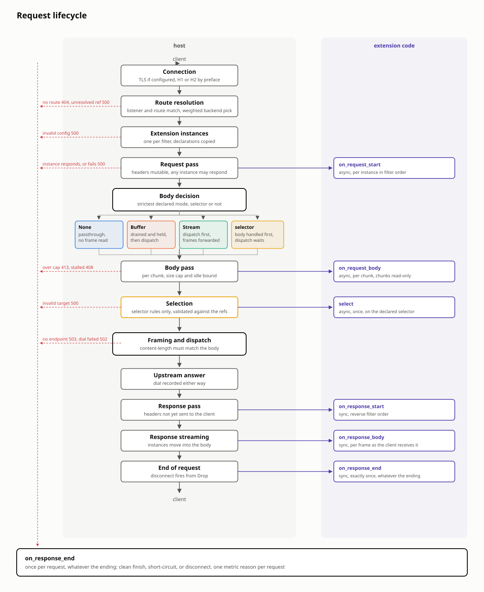

# Request flow

How the gateway runs, in order: the boot sequence of each binary, one
HTTP request from the accepted socket to the end of the response, and
the loops underneath that keep the config current.
[ARCHITECTURE.md](../ARCHITECTURE.md) says what each module owns; this
page says only when each module runs.

The request section covers the native path and the points where
extension code runs, which is the right-hand lane in the diagram. It
does not cover the precise semantics of each extension.

Names in this document are API names that you can grep for.

## Boot

### gateway-cp

`main` does the following, in this order.

1. Parse the flags and install the `tracing` subscriber; `RUST_LOG`
   filters the log, `info` by default.
2. Create the kube client.
3. Create two drain channels, one for the data tasks and one for the
   admin server, which drains after them.
4. Register SIGINT and SIGTERM and spawn the drain driver, with a
   five-second deadline for the data tasks.
5. Bind and spawn the admin server. `/healthz/ready` answers 503 and
   names the kinds that are still waiting until the first full pass over
   synced reflectors.
6. Spawn the elector. Every replica starts as a follower.
7. Spawn the infra writer, if `--dp-image` and `--cp-url` are both set.
8. Spawn the status writer.
9. Spawn the watch loop, `watch::run`.
10. Spawn the task that ends every config stream when the drain fires,
    so that the data planes reconnect to a peer replica.
11. Serve gRPC on `--listen` until the drain fires, then await every
    task.

### gatewayd

`main` does the following, in this order.

1. Parse the flags and install the subscriber, text or JSON per
   `--log-format`. One of `--config` and `--control-plane` must be set.
2. Create the Store, the `Metrics` and the Prometheus registry under
   the `gateway_` prefix.
3. Create the readiness latch. With `--config`, parse and validate the
   YAML, apply it to the Store and flip the latch at once. With
   `--control-plane`, the latch flips when the bootstrap is applied, and
   it never flips back.
4. Create the drain channels and spawn the drain driver with the
   `--drain-grace` deadline, 25 seconds by default.
5. Spawn the admin server, if `--admin-addr` is set.
6. With `--control-plane`, spawn the client. It sends `Hello` with the
   client id, applies the bootstrap and then each delta, and
   reconnects and re-bootstraps when the stream ends.
7. Build the extension `Registry`: the core filters and the kinference
   selector.
8. Run `Gateway::run`: one accept task per active bind, driven by the
   Store's `BindEvent`s, until the drain fires.
9. Await the driver, the client and the admin server.

## One request

### Preconditions

The `Store` holds the active configuration: binds, listeners, routes
with their matches, filters and backendRefs, and backends. A backend is
one of two kinds, which `ActiveBackendKind` names: a set of endpoints
that the request path balances over, or a dialable host that the
gateway resolves and dials itself. Both are reachable through the same
weighted refs, and both reduce to one `Destination` per request. Two
things live beside the config. Per-endpoint runtime state, the
`EndpointInfo` with its in-flight count, latency estimate and eviction,
persists across requests. The extension `Registry` holds one
`ExtensionBuilder` per plugin.

The control plane does not emit a dialable backend yet. Today one only
arrives through static config, including the TLS block that it
originates with.

Requests never observe a partially applied configuration. Partial
config, out-of-order references and resyncs are resolved at apply time,
not on the request path.

### Connection

The `Bind` accepts the socket and terminates TLS if the bind has it.
The HTTP version is detected, not configured: hyper's `auto::Builder`
checks for the HTTP/2 preface. One connection carries many requests,
sequentially on H1 and concurrently on H2, so nothing on the request
path may assume that it owns the connection. Everything below runs once
per request. On drain the connection signals the peer, finishes its
in-flight requests and releases the drop-counted drain barrier.
Failures here produce no request and no per-request metric.

### Route resolution

The request is matched to one `ActiveListener` and one
`ActiveHttpRoute`, or it fails with 404, reason `no_route`. A random
weighted pick over the route's `ActiveBackendRef`s chooses the backend.
A ref whose backend is not registered stays in the pick with its
weight, and a pick that lands on it fails with 500, reason
`backend_unresolved`. A route with no refs is valid, because redirect
routes proxy nothing. Resolution copies what it needs out of the Store
under a read lock and drops the lock, so a config change applied
mid-request affects the next request, not this one.

### Extension instances

Every filter resolves through an extension class. A core filter names
its reserved class, and an `ExtensionRef` names an `Extension` object
that carries the class, its config, its failure mode and its limits.
The class configures a builder once per route revision, and the runtime
caches the builder in `ExtensionCache`. Per request, each builder
constructs one `Instance`, which holds the hook receiver and the
builder's `Declarations`: `request_body`, `response` and
`selects_targets`. A resolution failure is cached for the revision and
logged once, and the route answers 500, reason `internal`, until the
config changes. Instances live until the response ends.

### Request pass

`on_request_start` runs on every instance in filter order, awaited one
at a time, with the mutable request head and the `Cx`. Each instance
returns an `Action`: `Continue`, `Respond(LocalResponse)`, which
answers the client with reason `ok` and contacts no upstream, or an
error. An error acts per the extension's `failureMode`: `Closed` fails
the request with 500, reason `internal`, and `Open` logs and continues.
A selector's errors always fail the request. Both early exits still
deliver `on_response_end`.

### Request body

The rule's body mode is the strictest that its instances declare:
`Buffer` over `Stream` over `None`. Under `None` no frame is read, and
the client's stream is handed to the upstream. Under `Stream` frames
flow from the client through the hooks to the upstream through a
four-frame channel, so a slow upstream backpressures the client. Under
`Buffer` the host drains the body before dispatch, within a size cap of
8 MiB, which answers 413, reason `body_too_large`, and an idle bound of
15 s per frame, which answers 408, reason `body_timeout`.

`on_request_body` runs per chunk on each instance that declared a mode,
and the final call has `end_of_stream: true`. A `Respond` from a body
hook discards the rest of the upload under `Buffer` and resets the
upstream request under `Stream`. When the rule has a selector, nothing
is dispatched until selection runs: the body is held under `Buffer`,
delivered to the hooks and dropped under `Stream`, or left unread under
`None`.

### Selection

On a rule with a selector, the weighted draw is not consulted. The
full ref list is the allowlist, which the selector reads through
`Cx::targets`. Each target carries its `origin`, the route backendRef
as the route named it; a ref that a `BackendBinding` claims reports the
claimed object, which is how the kinference selector learns the
`InferencePool`. The host calls `select` once, with the mutable head
and `Held`: `Buffered` with the complete body, `Untouched` when the
body is unread, or `Nothing` under `Stream`, in which case the selector
supplies the body to dispatch. The hook returns `Selected::Target`, a
target within the rule's refs plus the body source to forward, or
`Selected::Respond`. A selector may rewrite the request line, and path
and query move together. Every selection failure answers 500, reason
`internal`, with no fallback to the weighted draw: an error from the
selector, a target outside the rule's refs or unregistered, an
endpoint-set backend named as dialable, or a body source that cannot be
honored.

### Dispatch

The `content-length` sent upstream must match the body sent upstream.
The client's unaltered body keeps its header, a `Replace` body gets a
recomputed one, and a `Stream` body uses its declared total or goes
chunked. The request is then rewritten for the hop: the URI targets the
`Destination`, the wire version follows the backend's `BackendProtocol`
unless ALPN decides it over TLS, and hop-by-hop headers are stripped.
For an endpoint set the authority is the endpoint's `ip:port` and
`Host` is carried through. For a dialable backend the authority is its
`host:port`, the scheme is `https` when the backend has a TLS block,
`Host` is replaced, and the backend's path prefix is joined ahead of the
path.

A dialable backend with a TLS block is dialed by a client of its own,
`proxy::originate`, compiled once per `ActiveBackend.revision` from the
backend's trust roots, SNI override, ALPN list and insecure switch. A
TLS block that does not compile answers 500, reason
`backend_unresolved`, dials nothing, and is logged once per revision.
No response-header timeout applies: a backend that is slow to first
byte holds the request open.

### Upstream answer

A pick that finds no endpoints answers 503, reason `no_endpoint`. An
in-flight guard on the destination's `EndpointInfo` is held from the
pick until the handler returns. The dial is timed: success feeds the
latency estimate, and failure feeds passive eviction and answers 502,
reason `dial_failure`, with the cause chain on the log line. A dialable
backend's eviction is never consulted, because it has nothing to fail
open to. The upstream's headers are taken as is, and hop-by-hop
stripping waits until after the response pass.

### Response

`on_response_start` runs on every instance in reverse filter order,
sync, with the mutable response head; hop-by-hop stripping follows it.
The body streams to the client through hyper's polling, and the
instances move into the body wrapper, because the response outlives
the handler. `on_response_body` fires per frame, sync and read-only, on
instances that declared `ResponseMode::Tap`; for an LLM response the
first tap is the time-to-first-token moment. A route whose instances
all declared `ResponseMode::None` returns the body untouched.
`ResponseMode` has no `Buffer`, because holding a response back
defeats streaming it.

### End of request

Every request ends exactly once, and instances that declared
`ResponseMode::End` or `Tap` receive `ResponseEnd`: the status that the
client got, the body bytes delivered, `complete`, and `upstream`. The
hook fires when the response body finishes, from `Drop` when the client
disconnects mid-stream, or at once when the request was answered
without an upstream response. Endings before instantiation fire
nothing, because no instance exists to hear them.

**Before instantiation.** `on_response_end` does not fire.

| ending | status | reason |
|---|---|---|
| no listener or route matched | 404 | `no_route` |
| instantiation failed | 500 | `internal` |

**Answered without an upstream response.** `on_response_end` fires
immediately: zero body bytes, `complete: false`, `upstream: false`.

| ending | status | reason |
|---|---|---|
| an extension responded, in the request pass, the body pass or selection | the extension's status | `ok` |
| an extension failed, or a selection was invalid | 500 | `internal` |
| body over the size cap | 413 | `body_too_large` |
| body idle timeout | 408 | `body_timeout` |
| route has no refs but must proxy | 503 | `no_backend` |
| pick landed on an unregistered ref | 500 | `backend_unresolved` |
| no endpoint to pick | 503 | `no_endpoint` |

**Dispatched.** `on_response_end` fires when the response body
finishes.

| ending | status | reason | `complete` | `upstream` |
|---|---|---|---|---|
| dial failed | 502 | `dial_failure` | true, the 502 ran to its end | false, no upstream answered |
| the backend's TLS block does not compile | 500 | `backend_unresolved` | true, the 500 ran to its end | false, nothing was dialed |
| response delivered | upstream's status | `ok` | true | true |
| client disconnected mid-response | as sent | `ok` | false | true |
| upstream body failed mid-response | as sent | `ok` | false | true |

One metric reason per request, on every row. A `Buffer` route holds
each upload in memory and delays dispatch by the upload's duration, a
selector delays dispatch by its own decision time, and every other
cost is bounded by constants, not by traffic.

## The loops underneath

### The watch pass

`watch::run` keeps one `kube_runtime::reflector` per watched kind:
`GatewayClass`, `Gateway`, `HTTPRoute`, `Service`, `EndpointSlice`
filtered to slices that carry the `kubernetes.io/service-name` label,
`Secret`, and the gateway's own `Extension`, `GatewayBackend` and
`BackendBinding`. One `tokio::select!` over the watcher streams drives
the loop, and each relevant event triggers one pass: resolve,
translate, publish, status, infra.

Not every event is relevant. A status-only write does not bump
`metadata.generation` and changes nothing that the pass reads, so the
loop skips it. A `Gateway` event also passes on an annotation change,
because the provisioner reads annotations, and `Service`, `Secret` and
`EndpointSlice` events are never skipped.

The pass runs these stages, in order.

1. `resolve` makes every accept or reject decision exactly once: which
   Gateways are ours, how each listener classifies, which routes attach
   where, and whether backends and certificateRefs resolve. It records
   an outcome for accepted and rejected elements alike. Classification
   logic lives here and nowhere else.
2. `translate` maps the resolved graph onto one `Snapshot` per Gateway.
   A snapshot is a collection of proto upserts grouped by entity kind.
   An `HTTPRoute` that lists several parent Gateways lands in several
   snapshots. The translator only maps; it never re-decides.
3. `publish` diffs each Gateway's new snapshot against the last
   published one and broadcasts one `ConfigUpdate` per Gateway that
   changed. The diff walks the keys of both snapshots per entity kind:
   an unchanged value is skipped, an added or changed value is an
   `Upsert`, and a key that only the old snapshot had is a `Remove`.
   The upserts are ordered bind, backend, secret, listener, route for
   readable traces; the Store handles ordering across kinds through its
   stashing, so the order is convention, not correctness.
4. The status stage builds Gateway API status from the same outcomes
   and sends a `StatusWork` to the status writer through a `watch`
   channel. The writer writes only while this replica holds the lease.
5. The infra stage computes the desired gatewayd `Deployment`,
   `Service` and `ServiceAccount` for each owned Gateway and sends them
   to the infra writer through a `watch` channel. The writer writes only
   while this replica holds the lease.

Both writers sit behind channels, so a slow or failing apiserver write
never blocks the next pass or the publication of config to data planes.
The first full pass over synced reflectors flips the admin server to
ready.

### A data plane connects

The data plane opens the config stream and sends `Hello` with its
client id, the `{namespace}/{name}` of the Gateway that it serves. The
server subscribes to that Gateway's broadcast channel before it reads
the world, so that a concurrent publish arrives as a delta instead of
being lost. It then reads the world's slice for the Gateway and sends
it as one bootstrap `ConfigUpdate` with `sync_complete = true`. If no
slice exists yet, because the Gateway is unknown, the bootstrap is
empty. From then on the server forwards each broadcast item until the
stream closes.

On the data plane, `convert` turns each proto message into native
config types and keys, failing closed on anything missing or invalid,
and `apply` feeds the result into the Store. On each `sync_complete`
the client hands the bootstrap's key set to `Store::retain`, which
drops every key that the control plane no longer sends. The Store
promotes and demotes entities as their preconditions change, and a
bind that becomes active or inactive emits a `BindEvent`, which starts
or stops its accept task.

When the stream ends, the client reconnects and re-bootstraps. The
control plane ends every stream when it drains, so a rolling restart of
the control plane moves each data plane to a peer replica within one
reconnect.

### Leadership

gateway-cp elects a leader over a `coordination.k8s.io/v1` Lease in its
own namespace, with the pod name as the identity. The holder renews
inside a grace window before expiry. A rival waits out the current
claim's expiry before it tries, and a takeover bumps
`leaseTransitions`. Every write is an optimistic-concurrency replace
that carries the `resourceVersion` of the last-seen lease, so two
replicas racing for the same claim cannot both win: the loser gets a
conflict, re-reads and backs off. A clean shutdown vacates the lease so
that the peer takes over at once. Leadership gates only the status and
infra writers. Every replica translates and serves data planes, and
routing never waits on it.
