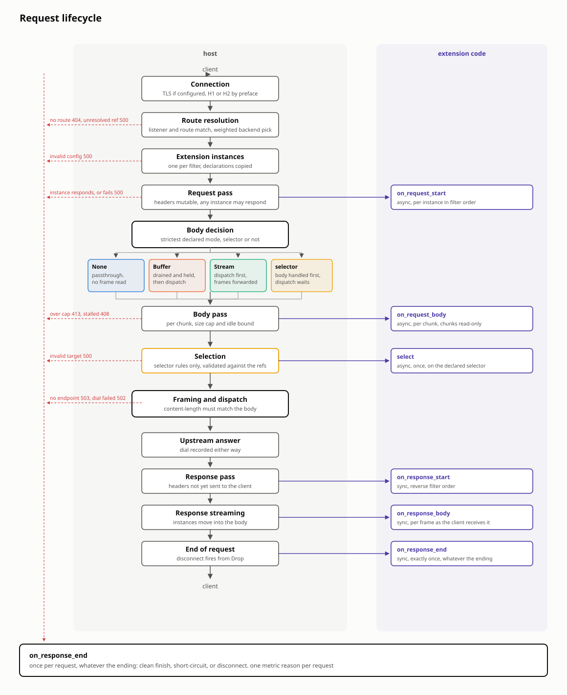

# Request lifecycle

How the gateway handles one HTTP request, from accepted socket to
the end of the response. Covers the native path and the points where extension
code runs (the right-hand lane in the diagram). This document
does not concern itself with:
- precise extension semantics
- how configuration reaches and modifies the runtime state of the
gateway

Names in this document are API names you can grep for.

## Preconditions

The `Store` holds the active configuration: binds, listeners, routes
(matches, filters, backendRefs), and backends. A backend is one of
two kinds (`ActiveBackendKind`): a set of endpoints the request path
balances over, or a dialable host. Everything below describes the
endpoint set — the dialable kind is not constructed by the control
plane and no path reaches it, so a route ref naming one resolves but
offers no endpoint, and the pick answers 503 `no_endpoint`. Two
things live beside it: per-endpoint runtime state (`EndpointInfo`:
in-flight count, latency estimate, eviction), which persists across
requests, and the extension `Registry`, one `ExtensionBuilder` per
plugin.

Requests never observe a partially applied configuration: partial
config, out-of-order references and resyncs are resolved at apply
time, not on the request path.

---

## Connection

The `Bind` accepts the socket. TLS termination happens here if the
bind has it. The rest of the path is identical for TLS and plaintext.
HTTP version is detected, not configured: hyper's `auto::Builder`
checks for the HTTP/2 preface and speaks H2 or HTTP/1.1 accordingly.

One connection carries many requests: sequentially on H1 (keep-alive),
concurrently on H2 (one stream per request). On H2 several requests
from the same connection can be in flight at once, so nothing on the
request path may assume it owns the connection. Everything below runs
once per request. On drain the connection signals the peer
(`Connection: close` on H1, GOAWAY on H2), finishes in-flight
requests, then releases the drain barrier. The barrier is
drop-counted: every connection task holds a handle, and shutdown
completes only when the last handle is dropped.

Failures here produce no request, so no per-request metric is
recorded.

## Route resolution

The request is matched to one `ActiveListener` and one
`ActiveHttpRoute`. The matching rules follow the config's routing
semantics (Gateway API-shaped) and are not specified here — they
change independently of the lifecycle. Exactly one route wins, or the
request fails with 404, reason `no_route`.

A random weighted pick over the route's `ActiveBackendRef`s chooses
the `ActiveBackend` for this request.

A ref names its backend by key and may be unresolved
(`backend: None`): the named backend is not currently registered —
it never arrived, or it was removed while the route stayed. Unresolved
refs keep their weight in the pick. A pick that lands on one fails the
request with 500, reason `backend_unresolved`; the share configured
for that ref fails rather than being redistributed onto the other
refs. The 500 (rather than 404) keeps config errors separable from
client errors in metrics and logs. A route whose weights sum to zero
has nothing to pick and fails the same way.

A route with no refs at all is valid (redirect routes proxy nothing).
"No backend" only becomes an error later, if no filter short-circuits
the request and it still needs forwarding.

Resolution copies what it needs out of the `Store` under a read lock
and drops the lock. The request runs against that snapshot; a config
change applied mid-request affects the next request, not this one.

The resolved rule keeps the full `ActiveBackendRef` list, not just the
drawn winner. Selector rules validate against the whole list.

## Extension instances

Every filter resolves through an extension class. An inline core
filter serializes its typed config and names its reserved class
(`class_and_config` is their funnel). An `ExtensionRef` resolves
through the route's `Extension` objects: the store rides each
referenced object along on the route (`ActiveExtensionRef`, like a
backend ref — resolved or not), and the object names the class and
carries its config, failure mode, and limits. The class configures a
builder once per route revision — the store stamps
`ActiveHttpRoute.revision` on every rebuild, and an `Extension`
upsert rebuilds every route referencing it — and the runtime caches
the result (`ExtensionCache`). Config parsing and validation happen
there, never per request.

Per request, each cached builder constructs one extension instance
(in code: `Instance`), holding the hook receiver and the builder's
`Declarations` (`request_body`, `response`, `selects_targets`). The
declarations drive everything downstream — the body tier, response
wrapping, `on_response_end` delivery.

Resolution can fail: a ref naming an `Extension` object that is not
registered, a filter naming a class the registry does not hold,
config the class rejects, or a declaration over the object's limits.
The failure is cached for the route's revision and logged once;
requests matching the route answer 500 (reason `internal`) until the
config changes. Two instances on
one route declaring `selects_targets` is checked per request as a
defensive backstop (500, log names the filters) — proper enforcement
is at config apply, before a route can receive traffic. A route never
serves with fewer filters than configured.

Instances live until the response ends, whatever the ending.

## Request pass

`on_request_start` runs on every instance, in filter order, one at a
time. The hook is async: the host awaits each before calling the
next. It receives the request head (mutable — header filters do their
work here) and the `Cx`, which at this point carries the matched path
prefix and the request host.

Each instance returns an `Action`:

- `Continue` — next instance.
- `Respond(LocalResponse)` — the pass stops. The client receives the
  response verbatim; no upstream is contacted. Reason `ok`: an
  extension answering directly (a redirect, a shed) is the route
  working as configured, not an error.
- An error acts per the extension's `failureMode`: `Closed` stops
  the pass and fails the request with 500 (`internal`); `Open` logs
  and continues to the next instance. The same rule applies in the
  body pass, per chunk — an `Open` instance that errors stays in the
  list for later chunks. Selection is exempt: a selector that cannot
  decide has no continue path, so `select` errors always fail the
  request.

Both early exits still deliver `on_response_end` to instances that
declared it.

## Body decision

The rule's effective body mode is the strictest its instances declare:
`BodyMode::Buffer` > `Stream` > `None`. That mode, combined with
whether an instance declared `selects_targets`, picks the machinery:

| declared | machinery | dispatch order | where the bytes are |
|---|---|---|---|
| all `None` | the client's stream is handed to the upstream connection; no frame is read | immediately | in transit, client → upstream; the gateway holds whatever hyper has in flight |
| `Buffer` | chunks delivered to hooks and accumulated; the complete body is forwarded | after the body | in the gateway, complete, until dispatched |
| `Stream`, no selector | frames flow client → hooks → upstream through a bounded channel | first | in transit; the gateway holds at most the channel's few frames |
| `Buffer`, with selector | body read and held; selection runs with it available | after selection | in the gateway, complete, offered to the selector as `Held::Buffered` |
| `Stream`, with selector | chunks delivered to hooks and dropped; no upstream exists yet | after selection | only where a hook sent them; the gateway keeps nothing |
| `None`, with selector | body left unread while selection runs | after selection | in the client's stream, unread, forwardable as-is |

Per-mode costs are tabulated at the end of the document.

## Body pass

`on_request_body` runs per chunk on every instance that declared a
body mode, in filter order, awaited like the request pass. Chunks are
read-only. The final call always has `end_of_stream: true`, with an empty chunk
when the body ends on a frame boundary.

Hooks return `Action`, as in the request pass. `Respond` stops the
body: under `Buffer` the rest of the upload is discarded; under
`Stream` the in-flight upstream request is aborted by injecting an
error into the channel, which resets the stream rather than
half-closing it — a half-close would read as a complete body. The client receives the
response with a clean status in both cases, because nothing has been
written to the client yet.

Per-mode specifics:

- **`Buffer`**: the host drains the body before dispatch. The
  accumulation is readable during hooks via
  `Cx::request_buffer`, including the current chunk. Bounds: a size
  cap (8 MiB, checked against `content-length` before reading when
  one is declared) → 413, reason `body_too_large`; an idle bound per
  frame (15 s, not a whole-body deadline — a large upload that keeps
  moving is not failed for being large) → 408, reason `body_timeout`.
  Request trailers are dropped: the body is re-sent as a complete
  buffer, which cannot carry them. A chunked upload is forwarded with
  a computed `content-length`.
- **`Stream`**: frames are forwarded as they arrive; nothing is
  retained and `Cx::request_buffer` is `None`. Forwarding runs on the
  request task itself (it borrows the instances and the `Cx`; no task
  is spawned). The channel is small (4 frames), so a slow upstream
  backpressures the client read instead of accumulating. Trailers
  pass through. The client's framing (`content-length` or chunked)
  is preserved.
- **`None`**: no hook fires, no frame is read, no bound applies
  beyond the upstream's own.

Bounds are global constants today; per-extension caps arrive with the
extension config object.

## Selection

Runs only on rules where an instance declared `selects_targets`,
after the request body has been read to its end (per the rule's mode;
under `None` it is left unread). For these rules the weighted draw from route
resolution is not consulted; the full `ActiveBackendRef` list becomes
the allowlist, exposed to the selector via `Cx::targets`.

The host calls `select` exactly once, on the one declaring instance.
The hook receives `Held`, which states what the host has of the
request body at this point:

- `Held::Buffered(&[u8])` — the complete body (the rule's mode was
  `Buffer`). The bytes travel in this argument, not in
  `Cx::request_buffer`: the hook borrows the context mutably, so the
  buffer cannot also be borrowed through it.
- `Held::Untouched` — no instance declared a body mode; the client's
  stream is unread and can be forwarded as-is.
- `Held::Nothing` — the rule's mode was `Stream`; chunks were
  delivered to the body hooks and dropped. With a selector present
  the gateway sent nothing upstream — no destination existed yet —
  so after the body pass the bytes exist only where a hook put them.
  A picker that forwards each chunk to its own service can later
  supply that service's (possibly rewritten) stream as the body to
  dispatch; a hook that only observed leaves no body at all.

`Held::forward()` turns what the host kept into the source to
forward, and returns `None` for `Held::Nothing`. A selector that
returns `Original` on a rule that retained nothing fails the request
(500, reason `internal`): the request would otherwise reach the
upstream stripped of its payload.

Any body mode may select. What varies is which body sources the
selector may return, and this follows the rule's effective mode — not
the selector's own declaration:

| rule's effective mode | `Held` received | body sources available |
|---|---|---|
| `None` | `Untouched` | `Original`, `Replace`, `Stream` |
| `Buffer` | `Buffered` | `Original`, `Replace`, `Stream` |
| `Stream` | `Nothing` | `Replace` or `Stream` only |

Two examples:

A rule with a header-based auth extension (`None` — it decides from
headers in `on_request_start`) and a bllmp picker (`Stream`,
selects). Effective mode: `Stream`. The body is delivered to the
picker's `on_request_body` chunk by chunk, and the picker forwards
each chunk to its service; the gateway retains nothing. `select`
receives `Held::Nothing`: `Original` is unavailable, and the picker
supplies the body to forward — typically the rewritten body streamed
back from its service, as `BodySource::Stream`. Retaining the body
here would charge `Buffer`'s memory cost to a rule that declared
`Stream`, so the obligation to supply the forwarded body sits with
the selector.

A rule with a metering extension (`Stream` — it counts request bytes)
and an inspecting picker (`Buffer`, selects — it reads the whole body
before deciding). Effective mode: `Buffer`, the stricter of the two.
The body is drained and held; the metering extension still receives
every chunk during the drain. `select` receives `Held::Buffered` and
may forward the original unchanged or return a `Replace`.

`select` returns `Selected`:

- `Selected::Target(Selection)` — a target plus the body source to
  forward. The target must name one of the rule's refs
  (`Target::Endpoint { backend, addr }`), and the address must be one
  the named backend lists. Lookup goes through
  `LoadBalancer::endpoint_by_addr`, which returns the same
  `EndpointInfo` the weighted path uses — selected requests share
  in-flight and latency accounting with balanced ones. Eviction is
  not consulted: a selector may pick an endpoint that passive health
  tracking evicted, on the grounds that its information (live worker
  metrics) supersedes dial-failure counters.
- `Selected::Respond(LocalResponse)` — the client receives the
  response; no upstream is contacted. Reason `ok`, as in the request
  pass: shedding is the route working as configured.

Failures, all 500 with reason `internal`, each with a distinct log
line: the selector returned an error (there is no fallback to the
weighted draw — a re-route would send traffic somewhere the selector
was configured to decide against); the target names a backend outside
the rule's refs, or a ref whose backend is not registered, or an
address the backend does not list; the target is a dialable backend
(`Target::Backend`), which nothing dials yet; the body source cannot
be honored.

## Framing and dispatch

The `content-length` sent upstream must equal the byte count of the
body sent upstream. Hyper transmits an explicit `content-length`
header verbatim, taking it over the body's own size hint, so a stale
header is not corrected in transit — the upstream receives a length
that contradicts the bytes. Enforcement is therefore here, per body
source:

| body forwarded | `content-length` handling |
|---|---|
| the client's, unaltered (any mode without selection, or `BodySource::Original`) | left as the client sent it — the bytes did not change, so the header still matches; a chunked upload drained under `Buffer` gets a computed length |
| `BodySource::Replace` | removed; hyper recomputes it from the replacement's exact size |
| `BodySource::Stream` with a declared total | set to the declared total before the first byte — with a streamed source this is the only way the upstream can distinguish a truncated request from a complete one. A source that ends short or long of its total fails, which resets the upstream request rather than completing it |
| `BodySource::Stream` without a total | removed; the request goes chunked |

Dispatch then rewrites the request for the hop: the URI targets the
chosen endpoint's address, the wire version follows the backend's
declared protocol (`BackendProtocol`; the client-side version does not
constrain the upstream side), and hop-by-hop headers are stripped —
required on H2, where a carried-over `Connection` or
`transfer-encoding` from a downstream H1 request is illegal and would
be rejected.

## Upstream answer

A pick that finds no endpoints answers 503, reason `no_endpoint` —
an endpoint set whose members are all gone, or a dialable backend,
which has no endpoints by construction. An
in-flight guard (`ActiveHandle`) is held on the chosen endpoint's
`EndpointInfo` from the pick until the request handler returns. The
count it maintains is an input to the balanced pick; acquiring it
after the body phase means a slow upload does not count as load on an
endpoint that has not been dialed yet.

The dial is timed and recorded either way: success feeds the dial
time into the endpoint's latency estimate, failure increments the
counter that drives passive eviction. A failed dial answers 502,
reason `dial_failure`.

The upstream's response headers are taken as-is; hop-by-hop stripping
is deferred until after the response pass, so extensions observe the
headers the upstream actually sent.

## Response pass

`on_response_start` runs on every instance in reverse filter order.
The hook is sync and receives the response head, mutable — nothing
has been written to the client yet. Response header filters do their
work in this pass.

Hop-by-hop stripping runs after the pass, so an extension cannot keep
a hop-by-hop header alive by re-adding it.

The pass returns nothing. Status and headers are committed when the
handler returns, and the body is not yet in view, so there is nothing
a return value could change.

## Response streaming

The response body streams to the client through hyper's polling, and
the extension instances go with it: they are moved into the response
body wrapper, because the response outlives the request handler.
Nothing is shared — the request phase borrowed the instances, the
response phase owns them.

`on_response_body` fires per frame, inside the poll, on instances that
declared `ResponseMode::Tap`. It is a sync, read-only tap:
it cannot delay, buffer or alter the stream, and the client receives
every frame exactly as the upstream sent it. The final call carries
`end_of_stream: true` under the same single-latch guarantee as the
request side. For an LLM response, the first tap call is the
time-to-first-token moment — response headers arrive before inference
starts, the first body frame after. The tap also runs on a response
synthesized after dispatch (a dial-failure 502); the terminal's
`upstream` field says which case the tap measured.

Wrapping is conditional: a route whose instances all declared
`ResponseMode::None` returns the upstream body untouched — no
wrapper, no per-frame overhead. Response buffering is not
representable: `ResponseMode` has no `Buffer`, because holding a
response back defeats streaming it.

## End of request

Every request ends exactly once, and instances that declared
`ResponseMode::End` or `Tap` are told how: `on_response_end` receives
`ResponseEnd` — the status the client got, the response body bytes
delivered, `complete`, true only if the response body ran to its
end, and `upstream`, true only if the status came from an upstream
response rather than being synthesized here.

The hook fires in one of two ways:

- **The request produced a response.** The hook fires when the
  response body finishes: at end of stream (`complete: true`), on a
  body error (`complete: false`), or from `Drop` when the client
  disconnects mid-stream (`complete: false`). `Drop` is why the hook
  is sync.
- **The request was answered without an upstream response** — a
  filter responded, a body limit hit, selection failed. The hook
  fires at that point, with the synthesized status, zero body bytes,
  `complete: false`.

The exception: endings before instantiation (no route matched, or
instantiation itself failed) fire nothing — no instance exists to
hear it.

Delivery is declared (`ResponseMode::End` exists apart from `Tap`)
because reading no body does not imply wanting no terminal: a rate
limiter settles its reservation at the end while reading no bytes.
Making delivery universal would wrap every response on every filtered
route to call empty hooks; the declaration keeps the wrapper on
routes that use it.

The endings, grouped by phase:

**Before instantiation** — `on_response_end` does not fire.

| ending | status | reason |
|---|---|---|
| no listener or route matched | 404 | `no_route` |
| instantiation failed | 500 | `internal` |

**Answered without an upstream response** — `on_response_end` fires
immediately: zero body bytes, `complete: false`, `upstream: false`.

| ending | status | reason |
|---|---|---|
| an extension responded (request pass, body pass, or selection) | the extension's status | `ok` |
| an extension failed, or a selection was invalid | 500 | `internal` |
| body over the size cap | 413 | `body_too_large` |
| body idle timeout | 408 | `body_timeout` |
| route has no refs but must proxy | 503 | `no_backend` |
| pick landed on an unregistered ref | 500 | `backend_unresolved` |
| no endpoint to pick | 503 | `no_endpoint` |

**Dispatched** — `on_response_end` fires when the response body finishes.

| ending | status | reason | `complete` | `upstream` |
|---|---|---|---|---|
| dial failed | 502 | `dial_failure` | true — the 502 ran to its end | false — no upstream answered |
| response delivered | upstream's status | `ok` | true | true |
| client disconnected mid-response | as sent | `ok` | false | true |
| upstream body failed mid-response | as sent | `ok` | false | true |

One metric reason per request, on every row.

## Costs

Per request, by what the route's instances declared. The `None` row
is every route without extensions, and every route whose extensions
only touch headers.

| declared | allocations | tasks | channels | peak body memory | added latency |
|---|---|---|---|---|---|
| `None` | none | none | none | hyper's in-flight buffers | none |
| request `Buffer` | one accumulation buffer | none | none | the whole body, ≤ 8 MiB | full body read before dispatch |
| request `Stream`, no selector | none | none | one, 4 frames deep | ≤ 4 frames | none — dispatch precedes the body |
| request `Stream` + selector | none | none | none | one chunk at a time | full body delivery before dispatch |
| response `Tap` or `End` | one boxed wrapper | none | none | none — frames pass through | none — taps run inside the poll |

A `Buffer` route holds each upload in memory and delays dispatch by
the upload's duration. A selector delays dispatch by the body
handling plus its own decision time. All other costs are bounded by
constants, not by traffic.
